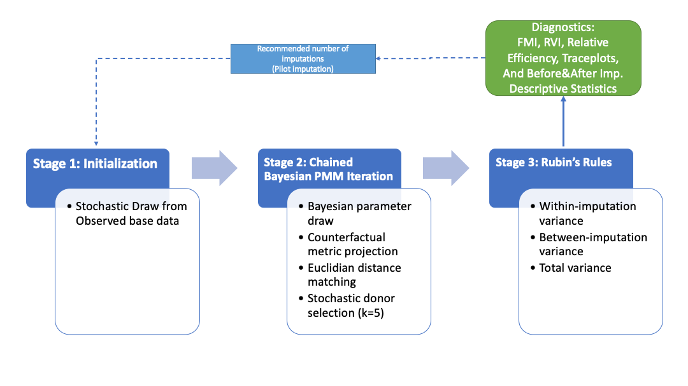
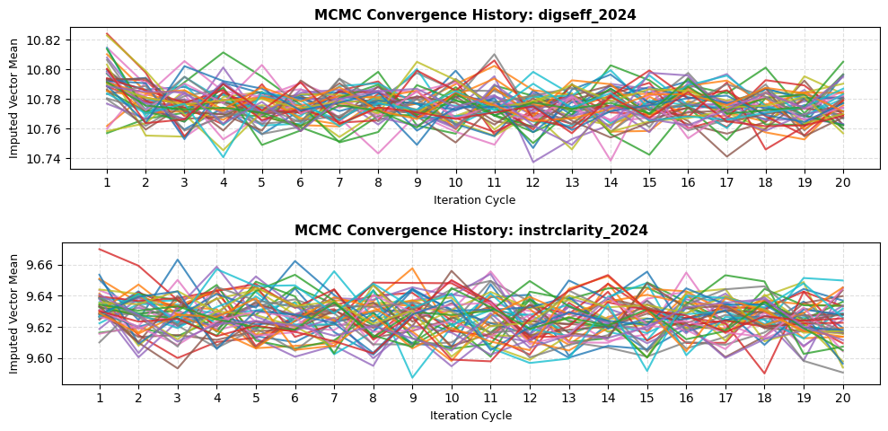
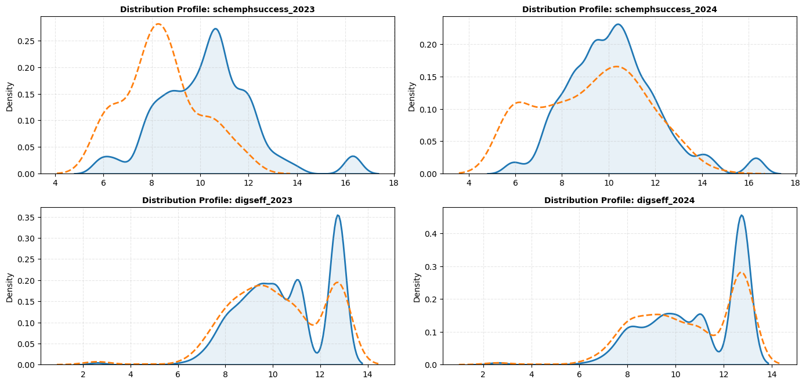
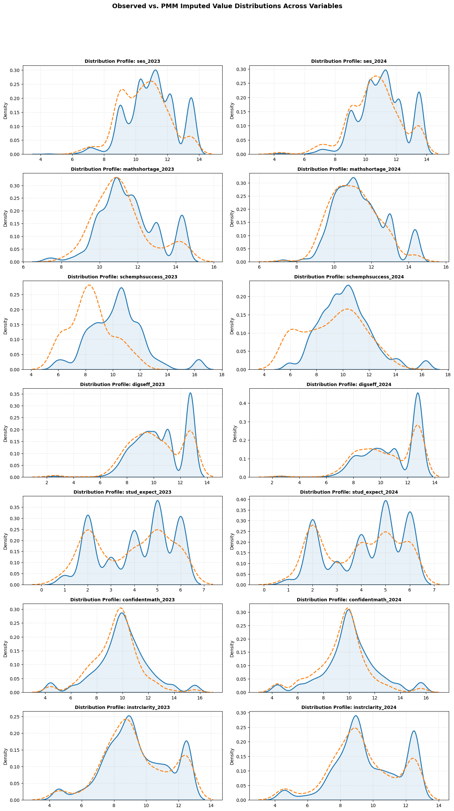

[](https://www.linkedin.com/in/orhan-kaplan-phd-5a4a84212/)
 

# 📊🔍 A Diagnostics Package for Multiple Imputation by Chained Equations (using PMM)
# Under Construction!!!

## 1. 📝 Summary
A from-scratch, `scikit-learn`-only implementation of Multiple Imputation by Chained Equations (MICE) with Predictive Mean Matching (PMM) based on *K*-nearest-neighbour (*K*-NN) donor selection, built for complex-survey data such as TIMSS and PISA. It runs the imputations and returns Rubin's (1987) pooling diagnostics (RVI, FMI, RE) and Von Hippel's (2020) recommended number of imputations, so that you can verify that your imputed results are stable and reproducible.


## 2. 🎯 Objectives

### Why: the case for principled imputation

In corporate data teams and academic research alike, listwise deletion (dropping every row that has at least one missing value in the variables used) remains the most common default for incomplete data (Guenther et al., 2023; Stavseth et al., 2019). Guenther et al. (2023) found that, since 2017, 33.1% of data analysts in business marketing research used listwise deletion and only 0.8% used imputation. Listwise deletion is quick and simple, but it may put internal, external and statistical conclusion validity at risk:  

- **Lost statistical power and signal.** Dropping rows removes valuable data and can shrink the sample substantially. If a customer skips one optional profile question, listwise deletion removes their entire purchase and behavioral history from the model; in a survey, a student who skips one item loses their whole record.
- **Selection bias.** Data are seldom missing completely at random. If particular groups (e.g., lower-income customers, historically underrepresented groups, specific regions) skip questionnaire items more often, listwise deletion **without a valid theoretical and methodological rationale** systematically removes those groups, and the resulting models reflect only respondents who complete every item. This reduces generalizability of the results by failing to accurately represent reality.
- **Wasted data acquisition costs.** Surveys, marketing pipelines and international assessment waves (e.g., TIMSS) require substantial investment, and discarding partially complete records throws away part of that investment in the absence of robust mathematical infrastructure necessary for the secure imputation of missing data elements.


### What: technical goals


Multiply imputing survey constructs for a complex-sample dataset such as TIMSS has three requirements that general-purpose Python imputation libraries do not jointly satisfy. This package is built to meet all three:

1. **Auditable PMM matching.** R's `mice` defaults to an asymmetric matching rule (`matchtype = 1`): donor-pool predictions use the non-stochastic OLS estimate (`beta_hat`), while the recipient's prediction uses a stochastic Bayesian posterior draw (`beta_star`). This is a documented parameter in `mice` and mirrors Stata's `mi impute pmm` default. Python alternatives either do not expose this choice or require reading undocumented source code to confirm what they do, which is a poor foundation for a method used in a study.
2. **Pooling diagnostics beyond point estimates.** Deciding *how many* imputations to run, and confirming that the imputation model behaves well, requires Rubin's Rules quantities (fraction of missing information, relative increase in variance, relative efficiency) and Von Hippel's (2020) two-stage recommended-*M* calculation. Most Python MICE wrappers pool parameter estimates but stop short of these diagnostics.
3. **Complex-survey compatibility.** TIMSS-style data come with sampling weights and jackknife repeated replication (JRR) variance structures. General-purpose imputers have no concept of a design weight and, because they are built as fixed `scikit-learn`-style pipelines, offer no natural place to keep weights, replicate-weight columns and other design metadata untouched and attached to each completed dataset.

Existing options were evaluated against these requirements. For example, `autoimpute` (Kearney & Barkat, 2019) has no weight argument in its `MiceImputer` or `PMMImputer` classes, does not expose the FMI/RVI/recommended-*M* diagnostics used here, and does not expose iteration-level convergence state (only the final completed dataset per chain).


## 3. 📂 Dataset

The sample application uses the longitudinal TIMSS 2023-L wide-format panel dataset (Sweden’s data), published by the IEA (Fishbein et al., 2026). The file contains 5,303 students and 1,155 variables. For 2023 and 2024, seven survey constructs are imputed, with two auxiliary predictors (Table 1).

- **Source:** Fishbein, B., Taneva, M., & Kowolik, K. (2026). TIMSS 2023 Longitudinal User Guide for International Database. Boston College, TIMSS & PIRLS International Study Center. https://timss2023.org/longitudinal/data
- **Size:** 5,303 students and 1,155 variables
- **Variables imputed and auxiliary variables:**  see Table 1 below

> **📋 Table 1:** Variables used in the sample application (percentages of missing values are computed before imputation).
>
> | Construct | Description | Role | Scale (observed range) | % missing 2023 | % missing 2024 |
> |---|---|---|---|---|---|
> | `ses` | Socioeconomic status | Imputed | Scale score (4.30–13.53) | 7.1 | 14.0 |
> | `mathshortage` | Shortage affecting mathematics instruction | Imputed | Scale score (7.28–14.33) | 2.4 | 3.4 |
> | `schemphsuccess` | School emphasis on academic success | Imputed | Scale score (5.85–16.30) | 2.4 | 4.4 |
> | `digseff` | Digital self-efficacy | Imputed | Scale score (2.60–12.75) | 9.8 | 16.0 |
> | `stud_expect` | Student's educational expectations | Imputed | Ordinal (1–6) | 8.8 | 15.5 |
> | `confidentmath` | Student confidence in mathematics | Imputed | Scale score (4.42–15.59) | 13.7 | 20.3 |
> | `instrclarity` | Clarity of mathematics instruction | Imputed | Scale score (4.57–12.49) | 12.7 | 18.6 |
> | `math1` | Mathematics achievement score | Auxiliary | Achievement score (2023: 65.07–805.05; 2024: 201.60–890.71) | 0.0 | 0.0 |
> | `school_math_mean` | School mean of `math1`, computed by `IDSCHOOL` | Auxiliary | Derived (2023: 416.51–610.43; 2024: 421.03–643.32) | 0.0 | 0.0 |

> [!NOTE]
> Variables were preprocessed before imputation (e.g., TIMSS missing-value codes such as `999999` or '9' are already recoded to `NaN`). Preprocessing is outside the scope of this repository, which expects a cleaned DataFrame as input.


## 4. 🔧 Methodology

The package treats missing data under a Missing at Random (MAR) assumption and follows van Buuren and Groothuis-Oudshoorn's (2011) three steps of imputation, analysis and pooling. The full derivations, formulas and worked examples are in the notebook: **`mice_imputation_diagnostics_helper.ipynb`**. In short, `mice_and_diagnostics()` does the following:

1. **Stochastic initialization.** Each missing cell is filled with a random draw from the observed values of that variable, which keeps the initial values inside the range and data type of the original scale.
2. **Fully conditional specification (FCS).** For a configurable number of burn-in iterations, the function cycles through every incomplete variable. All other columns, including fully observed auxiliary variables, act as predictors (customizable per variable through `predictor_map`).
3. **Bayesian linear regression and PMM donor matching.** For each variable, the model is fitted on the rows where the variable was originally observed, using a non-informative prior (Rubin, 1987, p. 167; van Buuren, 2018, Sec. 3.2): a χ² draw for the residual variance, then a multivariate normal draw for the coefficients. Following `mice` package's Type 1 matching, donor-pool predictions use `beta_hat` and recipient predictions use the stochastic `beta_star`. Each recipient is matched to its *K* nearest donors on the predicted-mean scale (default *K* = 5), one donor is selected at random, and the donor's **real, observed value** is imputed.
4. **Independent parallel chains.** Each of the `m_datasets` imputations is generated from its own independent RNG stream (`numpy`'s `SeedSequence.spawn`), as Rubin's Rules require.
5. **Pooling diagnostics.** Rubin's Rules give the pooled estimate, within-imputation variance, between-imputation variance and total variance, from which the package reports RVI, FMI and RE, plus Von Hippel's (2020) recommended *M* for each imputed variable.
6. **Convergence and plausibility checks.** Trace plots of the mean (and standard deviation) of each imputed variable across burn-in cycles and chains, plus observed-versus-imputed KDE overlays.
7. **Survey-weighted margins.** Population-weighted means before and after imputation, using a user-specified design-weight column.

> **🖼️ Figure 1:** The structural workflow of the MICE imputation engine (`mice_and_diagnostics()`).
>

> 


### 🎯 Why PMM?

PMM preserves the natural boundaries and structure of the data. Unlike regular regression imputation, which assumes multivariate normality and can produce unrealistic values (such as negative numbers, or decimals for categorical items), PMM copies every imputed value from a real, observed respondent (donor). This has three advantages for large-scale assessments:

- **Preserves scale boundaries:** categorical items (such as 1–4 Likert scales) stay within authentic, integer values.
- **Maintains non-linear relationships:** skewed variables can be handled without complex transformations.
- **Captures real variance:** randomised *K*-NN donor selection injects realistic, empirical noise, so downstream standard errors and variance components are not artificially deflated.

### 🔢 Choosing the number of imputations

Von Hippel (2020) recommends a two-stage procedure: run a pilot imputation (e.g., *M* = 10), read the recommended *M* for each imputed variable from the diagnostics table, and then run the final imputation with at least the largest recommended *M*.

### ⚖️ Design-weight caveat

Survey weights are used **only** for the before/after weighted margins reported at the end. They are not incorporated into the imputation regressions, which matches the unweighted default of R's `mice` and Stata's `mi impute pmm`. The function is written so that a case-weighted regression or a weight-based auxiliary predictor could be added directly to the regression step if an analysis calls for it (see Reiter, Raghunathan, & Kinney, 2006, on the risks of omitting design features from the imputation model; and Bouhlila & Sellaouti, 2013, who weighted each observation in their own TIMSS MICE application).


## 5. 📊 Key Findings & Model Performance

The results below come from the sample application (N = 5,303 students; 14 imputed and 4 auxiliary variables; *K* = 5; seed = 1234). A pilot imputation (*M* = 10, burn-in = 10) was used to determine the number of imputations, and the final imputation used *M* = 45 with a burn-in of 20 cycles.

### Headline results

- **Number of imputations.** In the pilot run, the recommended *M* ranged from 5 to 45. The largest value belonged to `digseff_2024` (45), followed by `instrclarity_2023` (34) and `instrclarity_2024` (25). Following the conservative rule, the final run used *M* = 45. In the final run, the largest recommended *M* is 18 (`instrclarity_2024`), so 45 imputations are more than sufficient.
- **Missing information.** In the final run, FMI ranges from 0.010 to 0.211 and RVI from 0.011 to 0.265. Relative efficiency is at least 0.995 for every variable. FMI exceeds 0.15 for three variables (`confidentmath_2024`, `instrclarity_2023`, `instrclarity_2024`) and RVI exceeds 0.15 for five, but none approaches 0.50.
- **Convergence.** In all 14 trace plots, the chains settle within the first two or three cycles and then fluctuate around a stable level with no visible drift over the remaining cycles (Figure 2 shows the two variables with the highest FMI).
- **Plausibility.** The imputed distributions follow the observed ones closely for most variables (Figure 3). The exception is `schemphsuccess_2023`, where the imputed values are shifted to the left; this is examined below.
- **Weighted margins.** Imputation changed the survey-weighted means by at most 1.3% (Table 3). All 14 shifts are small and in the same direction (downward).

> **📋 Table 2:** Pooled diagnostics for the final imputation (*M* = 45, burn-in = 20). The last two columns compare the recommended *M* from the pilot run (*M* = 10) with that from the final run. Recommended *M* values are floored at 5.
>
> | Variable | % missing | FMI | RVI | RE | Recommended *M* (pilot) | Recommended *M* (final) |
> |---|---|---|---|---|---|---|
> | `ses_2023` | 7.1 | 0.0379 | 0.0394 | 0.9992 | 6 | 5 |
> | `ses_2024` | 14.0 | 0.0567 | 0.0600 | 0.9987 | 6 | 5 |
> | `mathshortage_2023` | 2.4 | 0.0222 | 0.0226 | 0.9995 | 5 | 5 |
> | `mathshortage_2024` | 3.4 | 0.0238 | 0.0244 | 0.9995 | 5 | 5 |
> | `schemphsuccess_2023` | 2.4 | 0.0104 | 0.0105 | 0.9998 | 5 | 5 |
> | `schemphsuccess_2024` | 4.4 | 0.0188 | 0.0192 | 0.9996 | 5 | 5 |
> | `digseff_2023` | 9.8 | 0.0842 | 0.0916 | 0.9981 | 9 | 5 |
> | `digseff_2024` | 16.0 | 0.1474 | 0.1717 | 0.9967 | 45 | 10 |
> | `stud_expect_2023` | 8.8 | 0.0742 | 0.0798 | 0.9984 | 5 | 5 |
> | `stud_expect_2024` | 15.5 | 0.1395 | 0.1610 | 0.9969 | 9 | 9 |
> | `confidentmath_2023` | 13.7 | 0.1148 | 0.1290 | 0.9975 | 13 | 7 |
> | `confidentmath_2024` | 20.3 | 0.1511 | 0.1767 | 0.9967 | 20 | 10 |
> | `instrclarity_2023` | 12.7 | 0.1642 | 0.1950 | 0.9964 | 34 | 12 |
> | `instrclarity_2024` | 18.6 | 0.2111 | 0.2651 | 0.9953 | 25 | 18 |

The pilot's recommendations are higher than the final ones because FMI estimated from only 10 chains is noisy, and the two-stage procedure deliberately uses the upper confidence limit of FMI. For example, the pilot FMI of `digseff_2024` was 0.267 (recommended *M* = 45), while the final run with 45 chains estimates it at 0.147 (recommended *M* = 10). FMI also reflects more than the percentage of missing values: `ses_2024` (14.0% missing) has an FMI of 0.057, whereas `instrclarity_2023` (12.7% missing) has 0.164.

> **🖼️ Figure 2:** MCMC trace plots for the final imputation: mean of `digseff_2024` (top) and `instrclarity_2024` (bottom) across the 20 burn-in cycles, one line per chain (45 chains).
>
> 

> **🖼️ Figure 3:** Observed (solid blue, shaded) versus PMM-imputed (dashed orange) distributions from the first imputed dataset, for `schemphsuccess` (top) and `digseff` (bottom) in 2023 and 2024.
>
> 

<details>
<summary>Show observed-vs-imputed densities for all 14 imputed variables (Figure 4)</summary>



</details>

### A closer look at `schemphsuccess_2023`

The imputed distribution of `schemphsuccess_2023` peaks around 8, whereas the observed distribution peaks around 10.5 (Figure 3). To check whether this reflects a weak imputation model or a genuine difference between respondents and non-respondents, the notebook compares the two groups on the other variables and checks how well the predictors explain the target:

- Students missing `schemphsuccess_2023` have a markedly lower mean on `schemphsuccess_2024` (7.45 versus 10.25 among students with observed values) and lower mean mathematics achievement (`math1_2023`: 507.7 versus 514.6; `math1_2024`: 513.7 versus 525.6).
- The full predictor set explains about 65% of the variance of `schemphsuccess_2023` (R² = 0.653, 3,275 complete cases, 17 predictors).

This pattern is consistent with a well-specified model recovering a real difference between the groups, rather than a matching artefact. Note that the data alone cannot confirm the MAR assumption, so this is supporting evidence rather than proof.

> **📋 Table 3:** Survey-weighted means before imputation (observed cases only) and after imputation (pooled over the 45 completed datasets).
>
> | Variable | Before | After | Difference | Difference (%) |
> |---|---|---|---|---|
> | `ses_2023` | 11.015 | 10.981 | −0.034 | −0.31 |
> | `ses_2024` | 11.058 | 11.008 | −0.050 | −0.45 |
> | `mathshortage_2023` | 11.575 | 11.544 | −0.031 | −0.27 |
> | `mathshortage_2024` | 11.323 | 11.306 | −0.017 | −0.15 |
> | `schemphsuccess_2023` | 10.230 | 10.153 | −0.076 | −0.75 |
> | `schemphsuccess_2024` | 10.054 | 10.011 | −0.043 | −0.43 |
> | `digseff_2023` | 10.442 | 10.421 | −0.021 | −0.20 |
> | `digseff_2024` | 10.792 | 10.754 | −0.038 | −0.35 |
> | `stud_expect_2023` | 4.066 | 4.040 | −0.026 | −0.63 |
> | `stud_expect_2024` | 4.160 | 4.117 | −0.043 | −1.04 |
> | `confidentmath_2023` | 9.971 | 9.894 | −0.077 | −0.77 |
> | `confidentmath_2024` | 10.132 | 10.001 | −0.131 | −1.29 |
> | `instrclarity_2023` | 9.495 | 9.465 | −0.030 | −0.31 |
> | `instrclarity_2024` | 9.743 | 9.682 | −0.061 | −0.63 |

> ⚠️ **Note:** Make sure you have completely cleaned and checked your raw data matrix, and evaluated the missing mechanism before running the diagnostics helper package! The missing data pattern should at least satisfy MAR condition.

### Plain-language interpretation

In practice, 45 imputations are more than enough for this dataset: the final diagnostics call for at most 18, and relative efficiency is above 99.5% for every variable, so the pooled estimates would change very little with additional imputations. The chains settle within a few cycles, so a burn-in of 20 is sufficient. The variables with the most missing data (`confidentmath_2024`, `instrclarity_2024`, `digseff_2024`) carry the most missing information, but even there the FMI stays at or below about 0.21. Imputation shifts the weighted means by at most 1.3%, and every shift is downward. This suggests that students with missing values tend to score slightly lower on these constructs, a pattern that fits the `schemphsuccess_2023` check above.


## 6. 🧩 Business Questions & Key Insights

The diagnostics are meant to be read together, because each one catches a different failure mode:

| Question | Diagnostic | What it catches | Result in the sample run | If it fails |
|---|---|---|---|---|
| How many imputations do I need? | Recommended *M* table (pilot, then final run) | Too few imputations for reproducible standard errors | The pilot (*M* = 10) recommended up to 45 (`digseff_2024`); the final run needs at most 18, so *M* = 45 is more than sufficient | Re-run with *M* at least equal to the largest recommended *M* |
| How much information is lost to missing data? | FMI, RVI, RE | Variables whose results depend heavily on the imputation model | FMI 0.010–0.211, RVI 0.011–0.265, RE ≥ 0.995; highest for `confidentmath_2024`, `instrclarity_2023` and `instrclarity_2024` | Add informative predictors (`predictor_map`), increase *M*, and report estimates for these variables with caution |
| Has each chain converged? | MCMC trace plots | Non-convergence within a chain (unstable burn-in) | All 14 variables settle within 2–3 cycles, with no drift over the 20 cycles | Increase `burnin` |
| Do imputed values look like real data? | Observed-vs-imputed KDE | Marginal distribution mismatch | Close agreement for most variables; `schemphsuccess_2023` is shifted left, consistent with a real difference between respondents and non-respondents (R² = 0.653) | Compare the missing and observed groups on the predictors, check the model's R², and revisit `predictor_map` or `knn` |
| Did imputation shift population-level estimates? | Before/after weighted margins | Distortion of weighted means | Shifts of at most 1.3% (`confidentmath_2024`), all downward | Investigate the variables with the largest shifts, and consider whether design weights should enter the imputation model |

### 🔍 Rules of thumb for successful imputation

These are the guidelines used in this project; adjust them to your study.

| Rule | Sample run |
|---|---|
| 1. Run the largest recommended *M* across variables | ✅ *M* = 45 (final run needs at most 18) |
| 2. FMI and RVI generally below 0.15, with a few exceptions that do not exceed 0.50 | ✅ FMI above 0.15 for 3 variables and RVI above 0.15 for 5, all below 0.30 |
| 3. Relative efficiency above 0.95 for every variable | ✅ Minimum 0.995 |
| 4. Trace plots show well-mixed, converging chains (the "fuzzy caterpillar" pattern) | ✅ All 14 variables |
| 5. Imputed values stay within the observed range and follow the observed distribution | ✅ Within range by construction, since PMM copies observed values; one distribution mismatch (`schemphsuccess_2023`), investigated |
| 6. Descriptive statistics are similar before and after imputation | ✅ Weighted means shift by at most 1.3% |

### 💡 Key insights

- **Deleting incomplete rows would have been costly.** Only 3,275 of the 5,303 students (61.8%) have all 18 analysis variables observed, so listwise deletion would have discarded 2,028 students (38.2%).
- **Missing information is concentrated in a few variables.** `confidentmath`, `instrclarity` and `digseff` in 2024 carry the most. Results for these deserve the most caution, and they are the ones that drove the pilot's recommendation of 45 imputations.
- **Missingness is not just a matter of percentages.** `ses_2024` (14.0% missing) has an FMI of 0.057, while `instrclarity_2023` (12.7% missing) has 0.164, so how well the other variables predict the target matters as much as how much is missing.
- **A distribution mismatch is a prompt to investigate, not to dismiss.** For `schemphsuccess_2023`, comparing the missing and observed groups and checking the model's R² showed the shift was consistent with a real group difference.
- **Population-level estimates are stable.** Weighted means move by at most 1.3%, though every shift is downward, which suggests that students with missing values tend to score slightly lower.


## 7. ⚙️ Requirements

Tested with the following versions:

- Python 3.13.9
- `pandas` 2.3.3
- `numpy` 2.3.5
- `scikit-learn` 1.7.2
- `matplotlib` 3.10.6
- `seaborn` 0.13.2
- `pyarrow` 21.0.0 (needed to read the Parquet sample data in the notebook)

See `requirements.txt` for the full dependency list. To run the notebook you also need Jupyter (e.g., `pip install jupyterlab`).

**Contact:** Orhan Kaplan, PhD · [LinkedIn](https://www.linkedin.com/in/orhan-kaplan-phd-5a4a84212/) 


## 8. ▶️ How to Reproduce

1. **Clone the repository and install the dependencies:**

   ```bash
   git clone https://github.com/nalpako2027/mice_imputation_diagnostics_helper.git
   cd mice_imputation_diagnostics_helper
   pip install -r requirements.txt
   ```

2. **Get the publicly available TIMSS 2023-L data (SPSS Data – Grades 8 & 9 (42 MB)). https://timss2023.org/longitudinal/data
3. Merge student and school datasets for Sweden (or other available countries of your choice). Follow IEA instructions.
4. Clean the data and rename the variables (The variables were preprocessed for an upcoming project).
5. **Run the notebook: mice_imputation_diagnostics_helper.ipynb


### Function reference

`mice_and_diagnostics(df, imputed_cols, auxiliary_cols, m_datasets=10, burnin=10, knn=5, seed=1234, weight_var='TOTWGT', plot_diagnostics=True, label="Dataset", predictor_map=None)`

| Parameter | Type | Default | Description |
|---|---|---|---|
| `df` | `pd.DataFrame` | required | Input data containing the imputed, auxiliary and weight columns, with a unique index (e.g., student ID) |
| `imputed_cols` | `list[str]` | required | Columns with missing values to impute. Each one also serves as a predictor for the others unless overridden in `predictor_map` |
| `auxiliary_cols` | `list[str]` | required | Fully observed (no `NaN`) predictors that are used in the regressions but never imputed |
| `m_datasets` | `int` | `10` | Number of independent imputation chains (*M*). Drives the between-imputation variance and the FMI and recommended-*M* diagnostics |
| `burnin` | `int` | `10` | Number of FCS cycles per chain. Each cycle updates every imputed variable once, conditional on the current state of the others |
| `knn` | `int` | `5` | Number of nearest observed donors in the PMM pool. One donor is drawn at random from these |
| `seed` | `int` | `1234` | Seed for the root `SeedSequence`, which is spawned into `m_datasets` independent RNG streams |
| `weight_var` | `str` | `'TOTWGT'` | Design-weight column, used only for the before/after weighted margins, not in the imputation regressions |
| `plot_diagnostics` | `bool` | `True` | If `True`, draws trace plots (one per imputed variable) and the observed-vs-imputed KDE grid (first chain only) |
| `label` | `str` | `"Dataset"` | Label printed in the headers of the before/after weighted-margin output |
| `predictor_map` | `dict[str, list[str]]` | `None` | Optional per-variable predictor lists. Variables not listed use all other imputed and auxiliary columns |

| Returns | Description |
|---|---|
| `imputed_list` | List of `m_datasets` completed DataFrames, indexed like `df`. Each contains only the imputed and auxiliary columns, stored as floats. Other columns (IDs, weights, plausible values, replicate weights) must be reattached by index |
| `trace_df` | Long-format DataFrame with columns `Chain`, `Iteration`, `Variable` and `Mean`: the mean of the variable (observed and imputed values together) after each update |
| `diagnostic_table` | DataFrame indexed by imputed variable, with columns `RVI`, `FMI`, `Rel Efficiency`, `Current M` and `Recommended M` (floored at 5) |

> [!NOTE]
> The diagnostic table and the before/after weighted margins are also printed to the console. The weighted margins are printed only, not returned.


## 9. 🗂️ Project Structure


```
mice_imputation_diagnostics_helper/
├── README.md                    # This file
├── LICENSE                      # MIT License
├── Executive_Summary
├── requirements.txt             # Dependency list
├── mice_diagnostics.py          # mice_and_diagnostics() implementation
├── mice_imputation_diagnostics_helper.ipynb 
└── /images    # Folder with figures used in the README
```


## 10. ⚠️ Limitations & Further Recommendations

### Limitations

- **MAR assumption.** The engine assumes the missing data pattern is at least Missing at Random. Evaluate the missingness mechanism before running the package.
- **Weights are not in the imputation model.** Survey weights are used only for the before/after margins (see the design-weight caveat above).
- **Logical inconsistencies.** MICE can introduce technical problems (such as circular dependence or unimputed cells) and illogical or impossible combinations of values (such as a pregnant father). See van Buuren and Groothuis-Oudshoorn (2011, p. 6) for scenarios. As a precaution, run data-quality checks with logical assertions based on the theoretical framework of your research.
- **Data preparation.** Make sure the raw data matrix is completely cleaned and checked before running the package.


- **Cluster-level variables are imputed per student.** The function treats every row as an independent unit. Variables that are constant within a cluster (here the school-questionnaire scales `mathshortage` and `schemphsuccess`) can therefore receive different imputed values for students in the same school, and their between-imputation variance is understated. In the TIMSS 2023-L example, 5 whole schools are missing `schemphsuccess_2023`, and student-level PMM gave each of them 9–10 different values. The imputed values for this variable should be treated as illustrative.
  *Recommendation:* impute such variables on a school-level table (one row per school), merge the completed values back to the students, and then impute the student-level variables. This two-stage workflow is not implemented in the package.
- **Pooled diagnostics assume simple random sampling.** RVI, FMI and the recommended M are computed from the variance of the unweighted mean (s²/N). They ignore survey weights and clustering, so they are imputation-quality checks, not design-consistent standard errors.


### Further recommendations


## 11. 📚 References   

*   Bouhlila, D. S., & Sellaouti, F. (2013). Multiple imputation using chained equations for missing data in TIMSS: A case study. *Large-scale Assessments in Education, 1*, 4.
*   Efron, B., & Tibshirani, R. J. (1993). *An Introduction to the Bootstrap*. Chapman & Hall.
*   Fishbein, B., Taneva, M., & Kowolik, K. (2026). TIMSS 2023 Longitudinal User Guide for International Database. Boston College, TIMSS & PIRLS International Study Center. https://timss2023.org/longitudinal/data
*   Guenther, P., Guenther, M., Ringle, C. M., Zaefarian, G., & Cartwright, S. (2023). Improving PLS-SEM use for business marketing research. *Industrial Marketing Management, 111*, 127–142. https://doi.org/10.1016/j.indmarman.2023.03.010
*   Kearney, J., & Barkat, S. (2019). *autoimpute* [Python package].
*   Reiter, J. P., Raghunathan, T. E., & Kinney, S. K. (2006). The importance of modeling the sampling design in multiple imputation for missing data. *Survey Methodology, 32*(2), 143–149. 
*   Rubin, D. B. (1987). *Multiple imputation for nonresponse in surveys*. John Wiley & Sons. 
*   Stavseth, M. R., Clausen, T., & Røislien, J. (2019). How handling missing data may impact conclusions: A comparison of six different imputation methods for categorical questionnaire data. *SAGE Open Medicine, 7*, 2050312118822912. https://doi.org/10.1177/2050312118822912
*   van Buuren, S. (2018). *Flexible imputation of missing data* (2nd ed.). CRC Press.
*   van Buuren, S., & Groothuis-Oudshoorn, K. (2011). mice: Multivariate imputation by chained equations in R. *Journal of Statistical Software, 45*, 3. https://doi.org/10.18637/jss.v045.i03
*   Von Hippel, P. T. (2020). How many imputations do you need? A two-stage calculation using a fractional missing information index. *Sociological Methods & Research*, *49*(3), 699–718. 


## 12. License


## 13. 👤 Author / Attribution

Orhan Kaplan, PhD · [LinkedIn](https://www.linkedin.com/in/orhan-kaplan-phd-5a4a84212/)

The helper package is free to use. However, if you use it in research, publications, presentations or other work, please cite or acknowledge:

Kaplan, O. (2026). *A Diagnostics Package for Multiple Imputation by Chained Equations (using PMM)*. https://github.com/nalpako2027/mice_imputation_diagnostics_helper.git
